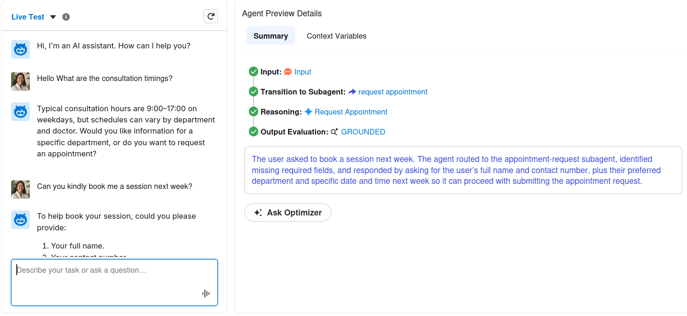
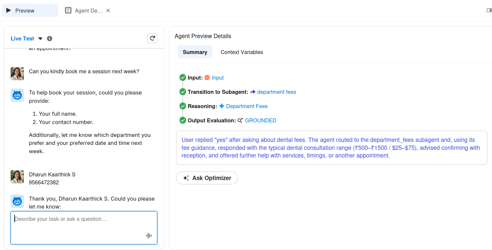
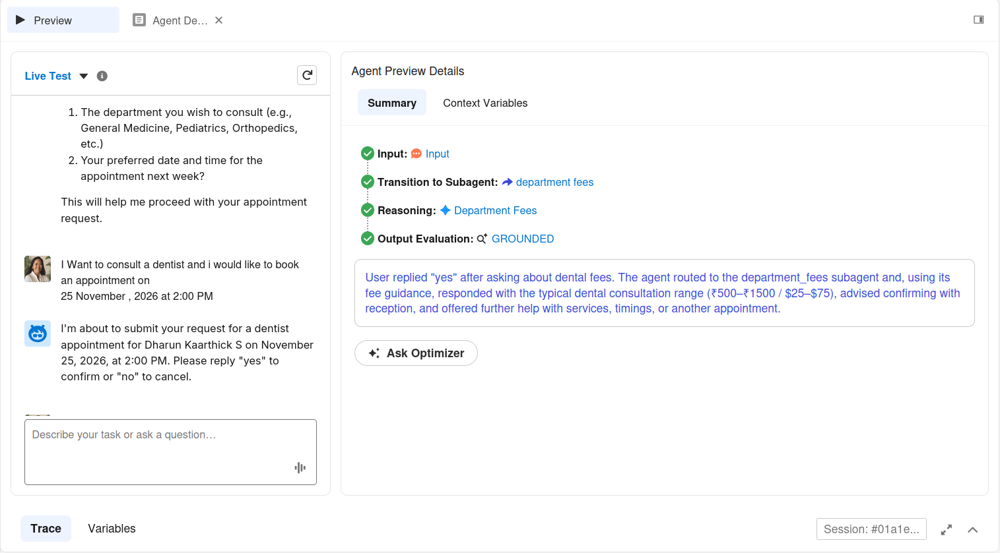
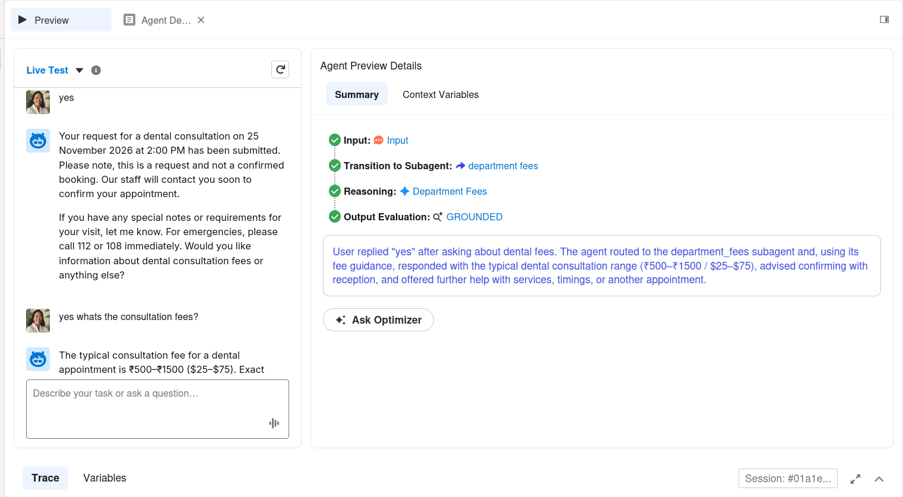
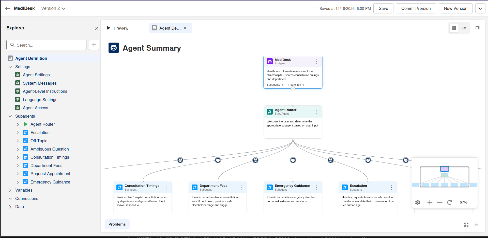

# MediDesk --- Healthcare Information Assistant

MediDesk is an AI-powered healthcare information assistant built using
Salesforce Agentforce. It helps users access hospital information,
including consultation timings, department-wise consultation fees, and
appointment requests.

The agent is designed to provide administrative and general hospital
information only. It does not diagnose medical conditions or provide
medical advice.

## Features

-   **Consultation Timings:** Provides general consultation hours and
    helps users ask about department-specific availability.
-   **Department Fees:** Shares available consultation-fee information
    by department and recommends confirming exact fees with hospital
    reception.
-   **Appointment Requests:** Collects the details needed to submit an
    appointment request, including the user's name, contact number,
    preferred department, date, and time.
-   **Emergency Guidance:** Directs users experiencing emergencies to
    call **112 or 108** immediately.
-   **Human Escalation:** Supports escalation to a live human agent when
    appropriate.
-   **Off-topic Handling:** Politely redirects unrelated requests.
-   **Ambiguous Query Handling:** Requests clarification when the user's
    question is unclear.

## Agent Architecture

MediDesk uses a main agent and specialized subagents to handle different
categories of user requests.

### Main Agent

**MediDesk** --- Healthcare information assistant for a clinic or
hospital. Shares consultation timings and department information and
routes requests to the appropriate subagent.

### Subagents

  -----------------------------------------------------------------------
  Subagent                            Responsibility
  ----------------------------------- -----------------------------------
  Agent Router                        Determines the appropriate subagent
                                      based on the user's input.

  Consultation Timings                Provides general and
                                      department-specific
                                      consultation-hour information.

  Department Fees                     Provides department-wise
                                      consultation fee information.

  Request Appointment                 Collects appointment details and
                                      submits an appointment request.

  Emergency Guidance                  Provides emergency direction
                                      without offering medical advice.

  Escalation                          Handles requests that need a live
                                      human agent.

  Off Topic                           Redirects requests unrelated to the
                                      assistant's healthcare-information
                                      scope.

  Ambiguous Question                  Asks the user for clarification
                                      when necessary.
  -----------------------------------------------------------------------

## Appointment Request Workflow

1.  The user requests an appointment.
2.  The agent routes the conversation to the **Request Appointment**
    subagent.
3.  The agent collects required information:
    -   Full name
    -   Contact number
    -   Preferred department
    -   Preferred appointment date
    -   Preferred appointment time
4.  The agent summarizes the appointment request.
5.  The user confirms the request.
6.  The agent submits the appointment request through the configured
    action.
7.  The user receives a submission confirmation.

**Important:** Submission of an appointment request does not mean the
appointment is confirmed. Hospital staff are expected to contact the
user to confirm availability and booking.

## Emergency Safety

MediDesk is not an emergency-response or medical-diagnosis system.

If a user describes an emergency, the Emergency Guidance subagent
should:

-   Avoid diagnosing the user's condition.
-   Avoid providing treatment instructions or medical advice.
-   Clearly advise the user to contact emergency services immediately.
-   Direct the user to call **112 or 108**.

## Example Questions

### Consultation Timings

-   What are the consultation timings?
-   Is the hospital open on Sundays?
-   What time does the cardiology department open?
-   Are doctors available in the evening?

### Department Fees

-   What is the consultation fee for cardiology?
-   How much does a dental consultation cost?
-   What are the consultation fees for orthopedics?

### Appointment Requests

-   I want to book an appointment with a dermatologist.
-   Can I request an appointment for tomorrow?
-   I would like to consult a dentist next week.
-   What information do you need to request an appointment?

### Emergency Handling

-   I am experiencing severe chest pain. What should I do?
-   Someone is unconscious. Can I book an appointment?
-   I am having difficulty breathing.

## Configured Action

The appointment-request subagent uses the configured appointment
submission action.

**Action:** `submit_appointment_request`

**Required inputs:** - `contactRecord` - `caseSubject` -
`caseDescription`

**Output:** - `caseRecord`

The action is used to submit the appointment request. The agent should
not represent the request as a confirmed booking unless confirmation is
provided by the hospital's booking system or staff.

## Safety and Scope

MediDesk must:

-   Provide only supported hospital information.
-   Avoid inventing consultation timings, fee amounts, or availability.
-   Clearly communicate when information is unavailable or requires
    confirmation from reception.
-   Never diagnose medical conditions.
-   Never provide medical advice or treatment instructions.
-   Direct emergencies to **112 or 108**.
-   Treat appointment submissions as requests, not confirmed bookings.

## Technology

-   Salesforce Agentforce
-   Agentforce Subagents
-   Agent Routing and Reasoning
-   Configured appointment-request action / flow
-   Human escalation capability

## Disclaimer

MediDesk provides administrative healthcare information and
appointment-request assistance. It is not a substitute for professional
medical advice, diagnosis, treatment, or emergency services. For
emergencies, call **112 or 108**.

## Screenshots

